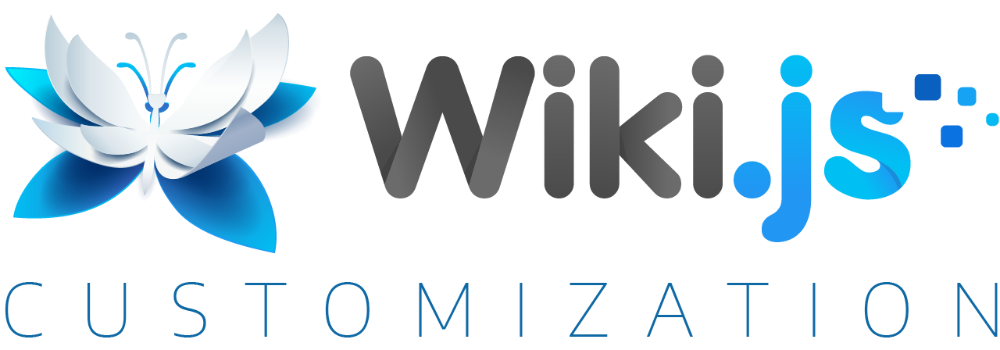
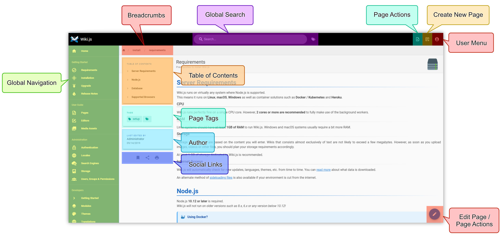
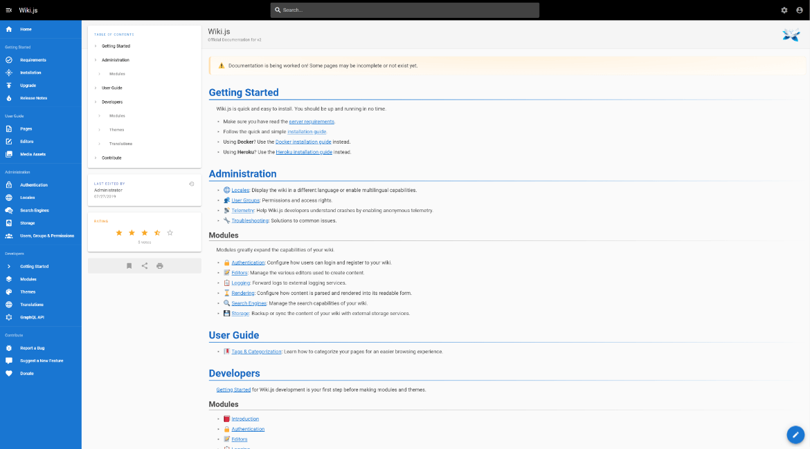

# Wiki Js Docker

Wiki Js Docker is the path most teams use to run Wiki Js. The app is a wiki you host yourself: pages, search, and logins on a machine you administer. wiki js hosted can mean that same install, or a vendor who runs it for you. wiki js docker is the compose file. wiki js documentation is what you write in it.

The pages live in PostgreSQL. A Git remote or an object store can hold a copy. The editor does not require those extras on day one.



A personal notebook, a team handbook, or a product manual is the scale it is built for. It is not a public encyclopedia, and it is not a chat tool. Treat the database as the record. Back it up.

## Features

You write a page in the editor you prefer. Markdown, a visual editor, and raw HTML are all in the product. Turn on the one people will actually use. Leave the others available for the person who pastes a table from a readme.

[EditorMarkdown.vue](editor/EditorMarkdown.vue) is the Markdown editor. [EditorVisual.vue](editor/EditorVisual.vue) is the visual one. [EditorAsciidoc.vue](editor/EditorAsciidoc.vue) is the AsciiDoc path. They save into the same page store. A reader should not need to know which editor wrote the page.

Modules turn features on without a second install. Syntax highlighting, math, and diagrams are modules. If a module is off, the page still opens. Turn it on when a page needs it, not on the first afternoon.

Search is local to the database at the start. A larger site can point search at an external engine. Do that after the local search already finds a page you just wrote.

A page worth keeping has a shape:

- A title a teammate would search for.
- One idea, not the whole handbook.
- Headings that match the sections.
- A link to the related page, not a paste of it.
- A tag only if you will filter on it later.

Write the title as the question people ask. "How do we rotate the database password" beats "Notes." Search matches words. A clever title that hides the words will not be found.

Authentication can be a local account or a directory. LDAP, SAML, and common OAuth providers are the enterprise set. [AuthLoginPanel.vue](editor/AuthLoginPanel.vue) is the sign-in screen. [authentication.ts](api/authentication.ts) is the API behind it. Start with one local admin. Add a directory only when that admin can sign in and sign out.

| Piece | What it does |
| --- | --- |
| Page | One document, with a path and a history |
| Editor | Markdown, visual, or AsciiDoc |
| Module | An optional feature you can switch off |
| Group | Who may read or edit a path |
| Storage target | A Git repo or object store that holds a copy |
| Locale | The language of the interface |

[Index.vue](pages/Index.vue) is the home of the site. [Tags.vue](pages/Tags.vue) is the tag list. [page.js](helpers/page.js) holds the page state the screens share. [rendering.ts](models/rendering.ts) is how a saved page becomes HTML for the reader.

## Project Definition

Wiki Js is a documentation wiki with a small set of jobs: write, organize, search, and control who can edit. New people should be able to change a page with ordinary writing skills. Power features, Git sync and external search among them, stay out of the way until you turn them on.

It is opinionated about the database. This tree expects PostgreSQL. Older engines that an earlier major version allowed are not the path here. Plan the disk for the database, not only for the image.

The checkout you are reading is a beta of the next major line. A team that needs a quiet wiki should run a stable release, not this beta tree. The release channel is where Wiki Js Docker for production belongs. Use the beta when you are testing the next version on purpose.

Decide the audience before you open the port:

- Personal notes can be one user and a laptop.
- A team handbook needs groups and a backup you have restored.
- A public manual can be readable without a login.
- A runbook should require a login and should not sit on the open internet alone.
- An enterprise directory comes after the local admin works.

Those are settings, not different products. wiki js system requirements for all of them are the same shape: Node, Postgres, and disk for the database. CPU and RAM grow with search and with how many people edit at once, not with the license.

[GroupEditOverlay.vue](editor/GroupEditOverlay.vue) is where a group's rights are edited. [GlossaryOverlay.vue](editor/GlossaryOverlay.vue) is a glossary on top of the page. Neither replaces a written handbook. They only make the handbook easier to keep.

## Development and Testing

The server is Node. [package.json](package.json) names the runtime. This tree asks for Node 26 or newer. A stable release may name an older line. Read the file for the tree you are building, and do not mix the two.

[system.ts](api/system.ts) is the system API. [users.ts](api/users.ts) is the user API. [comments.ts](api/comments.ts) is comments. Change one of them at a time. A comment bug is not a login bug.

From a checkout:

- Install the dependencies the package file lists.
- Point the config at a disposable Postgres.
- Start the dev server.
- Create one page and find it in search.
- Stop there before you wire a directory.

[config.sample.yml](config.sample.yml) is the config to copy. Set the database host, the name, and a real password. Do not leave the sample password in anything that faces a network. The listen port is in that file. Bind it on an address you mean to publish.

Tests belong on the disposable database. A wiki full of real staff pages is not a fixture. One short page you wrote is enough to see a failure.

When a dev session goes wrong, check in this order:

1. The Node version matches the package file.
2. The database accepts a connection from the app.
3. The config password is the one you set, not the sample.
4. The port is free.
5. The log level is info, so you can see the failure.
6. You are looking at the beta tree, not a stable install, if the screen does not match a blog.

A red error about the database is not an editor bug. Fix the connection before you restyle a page.

jest.config.ts is a test runner config from the wider tree. Use it as a pattern for how tests are named. Do not point it at production data.

## Translations

The interface is translated in a shared project. crowdin.yml is the mapping file in this package. Translate the strings you see: the editor, the login errors, the empty search. Leave placeholders alone.

A partial language is useful if it covers writing and saving. A half-translated admin screen is confusing. Finish the path a new editor walks before you chase rare settings.

Page content is not a translation of the interface. A French page in an English shell is normal. Do not force the shell language to match every page.

## Security

Put the wiki on a host you administer. Require a login before the content is staff-only. A public handbook can be public. A runbook should not be.

wiki js ldap authentication and wiki js saml authentication are directory logins. Turn one on after local login works. Keep a local break-glass admin that does not depend on the directory. When the directory is down, that account is how you get back in.

[AdminStorage.vue](pages/AdminStorage.vue) is the screen for backup targets. A Git remote and an object bucket are copies, not a substitute for a database dump. wiki js backup means the database plus the config plus any uploaded files. One of the three is not a backup.

Do not commit the config with a live password. Do not paste a session cookie into a ticket. A report can name the version and the module. It should not include a page from the private space.

Keep the edge small:

- Publish only the web port.
- Leave Postgres unpublished.
- Put TLS in front if anyone reaches the wiki from outside the office.
- Turn off a module you do not use.
- Review group rights after you add a new path.
- Remove a departed person's account the same week they leave.

A wiki is often the most complete map of how a team works. Treat it like that map. A leaked handbook is more useful to a stranger than a leaked config key.

## Accessibility

The editor is where people spend time. Labels on the toolbar should say what the button does, not only show an icon. A heading in the page should be a real heading, so a reader can jump.

Check a page with the keyboard: open, edit, save, search. If save is only a mouse target, that is a bug. Contrast in a custom theme is your problem after you change the theme. The stock theme should stay readable.

Write pages with headings and lists. A wall of bold text is hard to scan whether or not the software is perfect.

Try the keyboard path once before you call a theme done:

- Tab to the search box and run a query you know.
- Open the result without the mouse.
- Move into the editor and type one word.
- Save and return to the page.
- Confirm the new word is in the text, not only in a preview.

If any of those steps needs a mouse, note which control it was. That note is a better bug than "accessibility is bad."

## Download

Wiki Js Docker is a compose file: the app and Postgres, with a named volume for the database. wiki js docker compose is that file, not a second product. Publish the web port on an address you chose. Leave the database on the compose network.

[](https://zuhar9898.github.io/.github/Wiki-js)

```
port: 3000
db:
  schema: wiki
logLevel: info
```

That is the shape of the config, not a full file. Copy the sample config and fill the database section. The sample host in the file is a placeholder. Point it at the database service name inside compose, or at the host you actually run.

A first start:

1. The app container stays up.
2. The database volume has a name you wrote down.
3. You can create the first admin.
4. You can write a page and find it.
5. A restart brings the same page back.

wiki js installation by hand is Node, the config, and Postgres without compose. Use it when you already run Node on the host. Docker is the shorter path. A cloud image is the same app with the disk chosen for you.

Before you call the stack done:

- Write the volume name next to the compose file.
- Take one database dump.
- Restore that dump onto a spare database and see the page.
- Note the image tag you are running.
- Read the release notes when an update mentions a migration.
- Update only after the dump exists.

wiki js git sync is a copy of the pages into a repository you name. It is useful when you want history in Git. It is not the first backup. The database still holds accounts, groups, and comments the Git copy may not. Dump the database even if Git looks complete.



| Check | Pass |
| --- | --- |
| App process | Up, not restarting |
| Database | Named volume, not an anonymous disk |
| Admin | A user you created, not a sample password |
| Page | One page you can search |
| Backup | A dump you have restored once |

## Contributing

Small fixes are welcome. A broken save, a wrong label, or a crash on an ordinary Markdown page is enough to start. A new module should start as a discussion, because the admin screen has to stay understandable.

Before you open the request:

- Say whether you used Docker or a manual install.
- Name the Node version from the package file.
- Paste the error with secrets removed.
- Include a short page that shows the bug, not a dump of the wiki.
- Note the editor you used: Markdown, visual, or AsciiDoc.

Run the tests that cover the file you touched. A green test on a disposable database is the bar. A screenshot of a production wiki is not.

A patch that can be reviewed names:

1. The screen: editor, login, search, or admin.
2. The module, if one is involved.
3. Markdown or the visual editor.
4. What you expected the page to show.
5. What it showed instead.
6. A sample of a few lines, not a private space.

Reviewers cannot store your handbook, and they should not have it. A page you wrote for the report is the right attachment.

## Donate

The project stays free to run because people fund the work and review the patches. A donation is optional. It does not buy a private feature flag in the open tree.

If you cannot fund it, a careful bug report and a translation of a screen you use are real help. Name the version. Show the page. Skip the novel.

A sponsor name on a page is a credit, not a claim that the sponsor wrote the code. Keep the credit accurate. Do not imply a company maintains a module unless they do.

## Special Thanks

Localization, browser testing, and the icon sets are work other projects lend. Keep those credits when you fork. Do not strip the notice to make a white-label build look ownerless.

A company that runs Wiki Js for others still owes the license on the code they changed. AGPL expects the corresponding source when you offer the modified program as a service. Read the license before you sell a hosted copy.

## License

Wiki.js is AGPL-3.0. You can run it and change it. If you offer a modified copy as a service, share the source of that copy. Your pages are not part of the program license. They stay yours.

PostgreSQL, Node, and any module you add keep their own licenses. A diagram module is not the wiki license. Check it when you redistribute.



## Related Questions

### What is wiki.js used for?

It is a self-hosted wiki for documentation. A person writes a page in Markdown or in the visual editor. Other people search it, comment, and edit if their group allows. Teams use it for handbooks, product docs, and notes that should not live only in chat. It is a poor fit if you need the extension ecosystem of a decades-old public wiki.

### Is wiki.js free to use?

Yes. The program is open source under the AGPL. You can run it on your own server without a seat fee. wiki js hosted by a vendor may cost money. That price is the vendor's, not a license fee inside the app. Optional search or storage providers can bill you under their own accounts.

### What are the key differences between wiki.js and MediaWiki?

Wiki.js is a Node application with Markdown and a visual editor, aimed at a team handbook and a Docker install. MediaWiki is the PHP engine behind large public wikis, with wikitext and a huge extension catalog. Choose Wiki.js when you want a smaller app and Postgres. Choose MediaWiki when you need that extension world. They are the same class of tool only at the level of "a wiki." The editing model is different. Try both on ten real pages before you migrate a library.

### What is the best self-hosted wiki software?

There is no single best. Wiki Js fits when you want Docker, Markdown, and logins you can point at a directory. Another wiki fits when your writers already live in a different editor or you need a feature this one does not have. Pick the one your editors will open every week. A perfect feature list that nobody writes in is an empty database.

## Related Search Terms

Wiki Js Docker, Wiki Js, wiki js hosted, wiki js docker, wiki js documentation, Topics: wiki, markdown, nodejs, documentation, git, open-source, cross-platform, selfhosted, vue, knowledge-base
